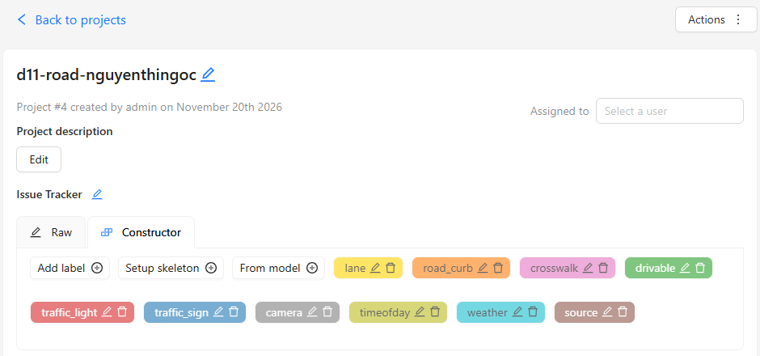
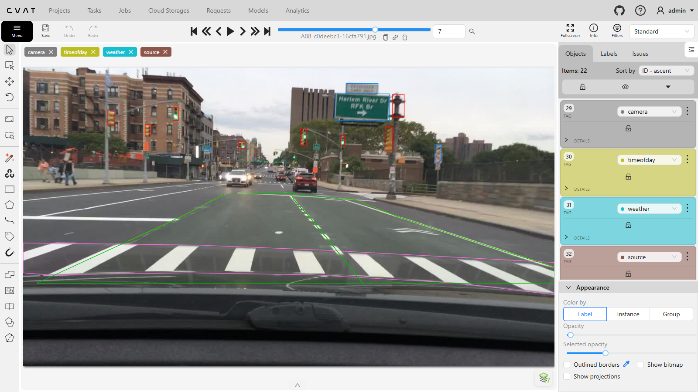
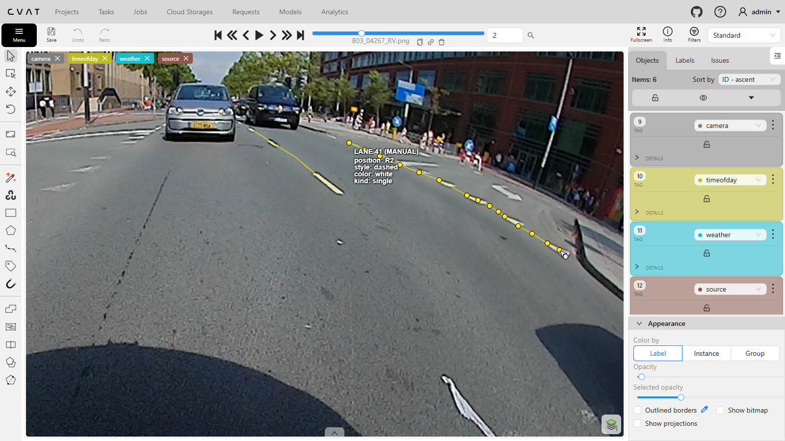

# Báo cáo cá nhân — Ngày 11
Họ tên: Nguyễn Thị Ngọc               Mã học viên: 2A202603236
Phiên bản CVAT (Help → About): v2.81.0 (CVAT chạy local)
Guideline: Road v1.0    Lần nộp (`revision` trong manifest): 1
Thời điểm export (ngày giờ trên CVAT): 2026-11-20 17:45    Số lần nộp lại sau Rework: 0

## 1. Kiểm project
| Mục | Đúng như guideline Road v1.0? | Ghi chú |
| --- | --- | --- |
| 6 label, đúng kiểu | Có | lane, road_curb (polyline); crosswalk, drivable (polygon); traffic_light, traffic_sign (rectangle) |
| Thuộc tính và giá trị | Có | Tạo từ `python -m road_lab.taxonomy` (Raw labels JSON); `weather` có `overcast` (bản taxonomy mới nhất) |
| 4 tag ảnh | Có | camera, timeofday, weather, source; mỗi label một thuộc tính select `value` |

Cách kết thúc polyline trên bản CVAT này: double-click điểm cuối, hoặc nhấn N.
Cách đặt tag ảnh trên bản CVAT này: chọn công cụ Tag ở thanh bên trái → chọn label (camera, …) → Tag; mở Objects/Details để đổi `value` (mặc định là giá trị đầu danh sách).

## 2. Số lượng đã gán
| Task | Ảnh | lane | road_curb | crosswalk | drivable | traffic_light | traffic_sign |
| --- | ---: | ---: | ---: | ---: | ---: | ---: | ---: |
| front | 12 | 32 | 3 | 4 | 20 | 22 | 21 |
| front-extra (đã làm 4 / 4) | 4 | 11 | 0 | 2 | 6 | 6 | 10 |
| fisheye | 8 | 5 | 2 | 4 | 3 | 6 | 0 |
| fisheye-extra (đã làm 4 / 4) | 4 | 1 | 0 | 3 | 1 | 0 | 0 |

Ảnh fisheye chỉ gán nhóm label trong bảng kế hoạch (`manifests/manifest_fisheye.csv`). B09 chỉ có tag: không thấy rõ vạch làn, đèn hay biển nào thuộc kế hoạch.

## 3. Bảng ca khó
| Ảnh | Nhãn | Phân vân giữa | Đã chọn | Lý do |
| --- | --- | --- | --- | --- |
| A05 | lane | vẽ L1/R1 ước lượng / không vẽ | không vẽ lane | Đường không có vạch sơn; guideline cấm vẽ thêm. Lint báo QC1-02; coach đã xem ảnh và xác nhận miễn |
| A03 | timeofday | day / dusk | dusk | Nắng thấp, xe bật đèn; ghi để lead xác nhận |
| A03 | lane R2 | vạch dải đỗ là lane / bỏ qua | lane R2, occluded | Vạch trắng ngăn làn với dải đỗ, đoạn xa bị xe đỗ che |
| A08 | lane L1 | vạch mờ là L1 / không có L1 | L1 dashed | Vạch đứt đã mòn nhưng vẫn thấy được giữa làn mình và làn trái |
| A09 | lane L1 kind/color | vàng đôi / trắng đôi | white, double | Hai vạch liền nhìn màu trắng trên ảnh (đường ở Israel) |
| A12 | lane L1/R1 | vạch trước vạch qua đường / làn sau giao lộ | vạch trước vạch qua đường | Gần xe không có vạch dọc rõ; vùng giao lộ |
| A06, A08, B02 | traffic_light color | unknown / off | unknown | Đèn nhìn nghiêng hoặc từ sau, không thấy đèn đang sáng |
| B03 | lane position (fisheye_rear) | L/R theo hướng xe / theo bên trong ảnh | theo bên trong ảnh | Guideline chưa nói rõ chiều L/R cho camera sau |
| B11 | lane | vạch vàng gạch chéo / vạch ô đỗ | 1 lane yellow, other | Theo kế hoạch: chỉ vạch dọc, bỏ vạch ô đỗ |

## 4. Phiếu QC 1 nhận được
Không thực hiện đổi lô / Phiếu QC 1 trong buổi này, nên không có phiếu nhận được.

Miễn QC1-02: A05 (nguyenthingoc-front.zip) — đường không có vạch kẻ làn nên không gán L1/R1; Lab Coach đã xem ảnh và xác nhận miễn QC1-02 (2026-11-20).

## 5. Kiểm file export
| File | Mở lại được? | Số shape ảnh 1 (job / file) | Số shape ảnh 2 (job / file) | Tag camera có trong XML? |
| --- | --- | --- | --- | --- |
| nguyenthingoc-front.zip | Có (`road_check lint` đọc được 16 ảnh) | A01: 9 / 9 | A02: 5 / 5 | Có (`front`) |
| nguyenthingoc-fisheye.zip | Có (`road_check lint` đọc được 12 ảnh) | B01: 1 / 1 | B02: 6 / 6 | Có (`fisheye_front`) |

Hai zip chỉ chứa `annotations.xml`, không kèm ảnh; manifest ghi `contains_images: false`, 28/28 ảnh đủ bốn tag. Lint còn 2 cảnh báo nặng, đều là QC1-02 ở A05 (không có vạch); coach đã xác nhận miễn, ghi ở mục 4.

## 6. Ảnh chụp màn hình
1. Tab Labels của project (Constructor: 6 label vẽ + 4 label tag).

   

2. Một ảnh camera trước đã gán đủ: A08 (làn L1/R1/R2, crosswalk, drivable direct/alternative, đèn, biển; 4 tag ở góc trên).

   

3. Một ảnh fisheye đã gán, phóng to đoạn polyline cong: B03 (fisheye_rear), lane R2 dashed đi theo cung, điểm dày ở đoạn cong.

   

4. Một đoạn XML có `<polyline label="lane">` (A01, file front):

```xml
<polyline label="lane" source="manual" occluded="0" points="111.00,719.00;142.00,690.00;180.00,660.00;227.30,620.00;269.50,582.00;297.40,556.00;320.80,537.00;335.00,527.00;352.00,515.00" z_order="0">
  <attribute name="position">L1</attribute>
  <attribute name="style">dashed</attribute>
  <attribute name="color">white</attribute>
  <attribute name="kind">single</attribute>
</polyline>
```

## 7. Tự đánh giá
Lỗi bạn mắc nhiều nhất hôm nay (theo mã QC1-xx), và cách tránh ở Ngày 20:
QC1-07 (vùng lái). Bản đầu, mép `direct` không bám L1/R1 (lệch 16–448 px; ở A09 gộp cả làn bên phải vào `direct`). Cách tránh: vẽ polyline làn trước, rồi vẽ polygon vùng lái bám đúng các điểm của L1 và R1; dải đỗ sát lề luôn để ngoài.

Nhãn của bạn đi vào model ở đâu? Chọn một lỗi đã sửa và nói nó làm model học sai thế nào:
Polygon `drivable` là đích của model phân đoạn vùng lái (drivable-area segmentation). Nếu `direct` tràn sang làn bên cạnh như A09 bản đầu, model học rằng làn bên cạnh cũng là "làn của mình". Planner hoặc LKA dựa trên đầu ra đó có thể cho xe lấn làn. Sửa lại để `direct` dừng đúng ở R1, làn bên phải gán `alternative`.

## 8. (Tùy chọn, buffer) Từ polyline đến đích row-anchor
Ảnh A01, vạch R1 (dashed, white), số liệu từ `python -m road_lab.rowanchor nguyenthingoc-front.zip --image A01`:

| y | 720 | 680 | 640 | 600 | 560 |
| --- | ---: | ---: | ---: | ---: | ---: |
| x của tôi | không có làn | 665.5 | 603.0 | 543.4 | 483.5 |
| x của bạn kia | — | — | — | — | — |

(Không đổi lô trong buổi này nên không có số của bạn kia. Tham khảo thêm L1 của A01: 720 → không có làn, 680 → 154.7, 640 → 203.7, 600 → 249.5, 560 → 293.1.)

Trả lời 3 câu:

1. Polyline R1 của A01 đi từ y = 715 (gần) tới y ≈ 518 (xa). Nếu dừng sớm 40 px ở đầu xa (kết thúc ở y ≈ 558), năm hàng trong bảng không đổi; chỉ các hàng trên 558 (xa hơn) thành "không có làn". Nếu thiếu 40 px ở đầu gần (bắt đầu từ y ≈ 675), hàng 720 và 680 thành "không có làn". Thực tế hàng 720 đã là "không có làn" vì điểm đầu R1 đặt ở y = 715, không chạm đáy ảnh. Điều này cho thấy điểm đầu sát xe quan trọng nhất (quy tắc 2 của guideline): thiếu vài pixel ở đáy là mất cả một hàng đích.
2. Không có số của bạn kia vì không đổi lô. Về nguyên tắc, lệch ở hàng 720 (sát xe) ảnh hưởng LKA nhiều hơn hàng 560: hàng gần là nơi LKA đo khoảng cách ngang từ xe tới vạch ngay lúc này, nên lệch ở đó đi thẳng vào sai số vị trí ngang và quyết định có cảnh báo / đánh lái hay không (dù ở gần mỗi pixel ứng với ít mét hơn ở xa); hàng xa chủ yếu ảnh hưởng ước lượng hướng và độ cong của làn phía trước.
3. Cách tính không đổi: `rowanchor` nội suy tuyến tính giữa hai điểm kẹp hàng y, không phụ thuộc thứ tự điểm, nên năm số x giống hệt. Script gặp khó là những chỗ giả định điểm đầu là điểm gần: lint / `road_check` (QC1-04 kiểm "điểm đầu cao hơn điểm cuối"), cảnh báo của chính `rowanchor`, và các bộ chuyển đổi dữ liệu huấn luyện lấy `points[0]` làm điểm neo gần xe hoặc đo điểm dừng ở hai đầu.
